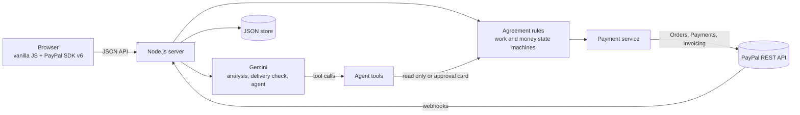

# TrustFlow AI

**AI turns a freelance deal written in everyday words into milestones with clear checks. PayPal holds each payment and releases it only when the client approves the work.**

- Live demo: `https://YOUR-APP.onrender.com` *(free hosting; the first load after a quiet period can take about a minute)*
- Demo video: `https://youtu.be/YOUR-VIDEO`

## The problem

Freelancers, tutors and designers usually agree on work in a chat message. “A modern website for $900, the last $200 after testing” sounds clear until the work is done. Then “modern” means different things, nobody agreed on who tests, and the last payment never comes. Most independent workers cannot afford a lawyer to write a contract, and most clients do not want to pay up front for work they have not seen.

## What TrustFlow does

1. **Describe the deal in your own words.** Any language works.
2. **The AI proofreads it.** Vague words like “modern” or “after testing” are underlined in the user’s own text, each with a one-line question and suggested wording. A clarity score shows how likely the deal is to end in a dispute.
3. **Answers become terms.** The AI rewrites the milestones with acceptance checks both sides can verify, and the score goes up.
4. **Both sides accept.** The terms lock.
5. **The client funds a milestone with PayPal.** The money is put on hold with a PayPal authorization, not charged.
6. **The freelancer submits the work.** The AI compares the delivery note with every acceptance check and tells the client what has evidence and what to look at.
7. **The client approves, and PayPal releases the money** (capture). Or the client asks for changes and the hold stays. Or the milestone is cancelled and the hold is voided, so nobody is charged.
8. **Milestones paid after delivery are billed with a PayPal invoice.**

A **payment agent** (Gemini function calling) works for whichever side is using the app. It reads the agreement, checks live status in PayPal, prepares invoices and proposes payment releases. **It never moves money by itself.** Every money movement becomes an approval card that a human approves or declines.

## How PayPal is used

| PayPal capability | Where it is used |
|---|---|
| **JavaScript SDK v6** (`createInstance`, `findEligibleMethods`, `createPayPalOneTimePaymentSession`, `<paypal-button>`) | The client funds a milestone in a PayPal popup. Falls back to a full-page redirect if the popup is unavailable. |
| **Orders API v2** with `intent: AUTHORIZE` | Each milestone becomes an order. Approval places a hold instead of a charge. |
| **Payments API v2**: authorize, capture, void, get authorization | Capture when the client approves the work, void when a milestone is cancelled, live status for the “Refresh from PayPal” button and for the agent. |
| **Invoicing API v2**: create draft, send, get, delete draft | Billing milestones that were approved without a hold. The agent creates the draft; the freelancer approves sending it. |
| **Webhooks** with signature verification | `PAYMENT.CAPTURE.COMPLETED`, `PAYMENT.AUTHORIZATION.VOIDED`, `INVOICING.INVOICE.PAID`, `INVOICING.INVOICE.CANCELLED`. Unverified events are ignored. |
| **OAuth 2.0** client credentials | Server-side token, cached until it expires. |

Every write call sends a `PayPal-Request-Id`, so a retry or a double click returns the original result instead of creating a second order, capture or invoice. The server only accepts the order it created for a milestone, and checks that the authorized amount and currency match the milestone before marking it funded.

## How AI is used

The app uses **Google Gemini** through its REST API, with structured JSON output and function calling.

| Feature | What the model does | What the code still checks |
|---|---|---|
| Agreement analysis | Extracts milestones, deliverables, acceptance checks, and the gaps that cause disputes, with exact quotes from the user’s text. | Quotes are only highlighted if they really occur in the text. Amounts are converted to integer cents. Currency must be one PayPal supports. |
| Clarification | Rebuilds the milestones with the parties’ answers. | The clarity score is plain arithmetic over the issues found, so it means the same thing every time. |
| Delivery check | Rates each acceptance check as met, unclear or not met, and says what the client should open to confirm it. | The result is aligned to the real list of checks. The model is told it cannot open links and must not claim it did. The client decides. |
| Payment agent | Plans with function calling: `get_agreement_state`, `check_paypal_status`, `prepare_invoice`, `propose_release_payment`, `propose_cancel_milestone`. | Tools are limited by role. Every money movement is an approval card run through the same rules as the buttons. |

Inputs from users are treated as data in every prompt. AI calls are rate limited per browser so a public demo cannot use up the quota.

## Try it as a judge

1. Open the live demo. Press **Bakery website, $900** to load an example instantly, or paste your own deal and press **Check my agreement**.
2. Answer one or two questions and press **Update agreement with my answers**. Watch the clarity score change.
3. Press **Accept as the client**. Switch to **Freelancer** at the top and press **Accept as the freelancer**. Switch back to **Client**.
4. Open milestone 1 and press **Fund $300.00 with PayPal**. Log in with the sandbox buyer below. The milestone now shows **On hold in PayPal**.
5. Switch to **Freelancer**, press **Submit work**, write a short note and add a link.
6. Switch to **Client**. Read the AI delivery check, then either press **Approve and release $300.00**, or ask the agent: *“Release milestone 1 if the check looks good”* and approve its card.
7. For milestone 2, approve the work without funding it, switch to **Freelancer** and ask the agent: *“Invoice the client for approved work.”* Approve the card to send the PayPal invoice.

**PayPal sandbox buyer** (test money only)

- Email: `YOUR-SANDBOX-BUYER-EMAIL`
- Password: `YOUR-SANDBOX-BUYER-PASSWORD`

Each browser gets a private workspace, so judges do not see each other’s agreements.

## Run it locally

Requirements: **Node.js 20 or newer**. There are no npm dependencies.

```bash
cp .env.example .env      # then fill in the values
npm start                 # http://localhost:3000
```

| Variable | Where to get it |
|---|---|
| `PAYPAL_CLIENT_ID`, `PAYPAL_CLIENT_SECRET` | [PayPal Developer Dashboard](https://developer.paypal.com/dashboard/) → Apps & Credentials → Sandbox → your app. Under the app’s **Features**, keep **Invoicing** enabled. |
| `GEMINI_API_KEY` | [Google AI Studio](https://aistudio.google.com/) → Get API key |
| `GEMINI_MODEL` | Defaults to `gemini-3.8-flash` |
| `DEMO_CLIENT_EMAIL` *(optional)* | Your sandbox Personal account email, prefilled as the invoice recipient |
| `PAYPAL_WEBHOOK_ID` *(optional)* | See webhooks below |

Without any keys the app still starts and explains what is missing. The examples work without the AI key.

## Deploy to Render

1. Push this repository to GitHub.
2. In [Render](https://render.com), choose **New → Blueprint** and select the repository. `render.yaml` sets everything up.
3. Enter the values for the environment variables when Render asks, and deploy.

Data is kept in a JSON file. On Render’s free plan the disk resets when the service restarts, which is fine for a demo; the built-in examples recreate an agreement in one click.

### Webhooks (optional)

In the PayPal Developer Dashboard open your app, add a webhook with the URL `https://YOUR-APP.onrender.com/api/webhooks/paypal`, and select the events listed above. Copy the webhook id into `PAYPAL_WEBHOOK_ID`. Without webhooks, the **Refresh from PayPal** button and the agent read the same status on demand.

## Tests

```bash
npm test
```

An end-to-end test runs the whole product against local mocks of the PayPal and Gemini APIs: analysis, clarification, acceptance, an `AUTHORIZE` order, authorization, submission, AI delivery check, release through an agent approval card, invoicing, invoice payment sync, and cancelling with a void. It also checks that the agent never captures money without approval, foreign order ids are rejected, workspaces are isolated, and unverified webhooks are ignored.

To work on the interface without any keys: `node test/dev-with-mocks.mjs`.

## Architecture



```
server.js               entry point, loads .env
src/app.js              HTTP server, per-browser workspace cookie, errors
src/routes.js           API endpoints
src/domain/             agreement model, clarity score, state machines
src/services/           payment orchestration (the only code that moves money)
src/paypal/             REST client, orders and payments, invoicing, webhooks
src/ai/                 Gemini client, prompts and schemas, analyst, reviewer, agent
public/                 interface (no build step)
test/                   end-to-end test and API mocks
```

Each milestone has two separate tracks, and every change goes through one set of rules used by both the buttons and the agent:

- **Work:** in progress → waiting for review → approved, with changes requested or cancelled as side paths.
- **Money:** not funded → on hold → paid out, or on hold → hold voided, or not funded → invoice sent → paid.

## Design choices

- **Humans approve money.** The AI explains, prepares and proposes. People decide.
- **No legal claims.** TrustFlow helps two people understand each other. It is not legal advice and not a licensed escrow service. The hold is a standard PayPal authorization.
- **Explainable numbers.** The clarity score is arithmetic the user can expand and read.
- **Accessible by default.** High-legibility type (Atkinson Hyperlegible), keyboard focus, screen reader labels, light and dark themes, reduced motion respected, works on phones.

## Limitations and what’s next

- PayPal authorizations are valid for a limited time, so long milestones need re-authorization or funding closer to delivery.
- In this prototype the freelancer is the PayPal merchant account behind the app. A marketplace version would use PayPal multiparty payments to pay many freelancers and take a platform fee.
- Next: shareable agreement links so each side uses their own device, reminders before a hold expires, and exporting the agreed terms as a document.

## License

[MIT](LICENSE)
